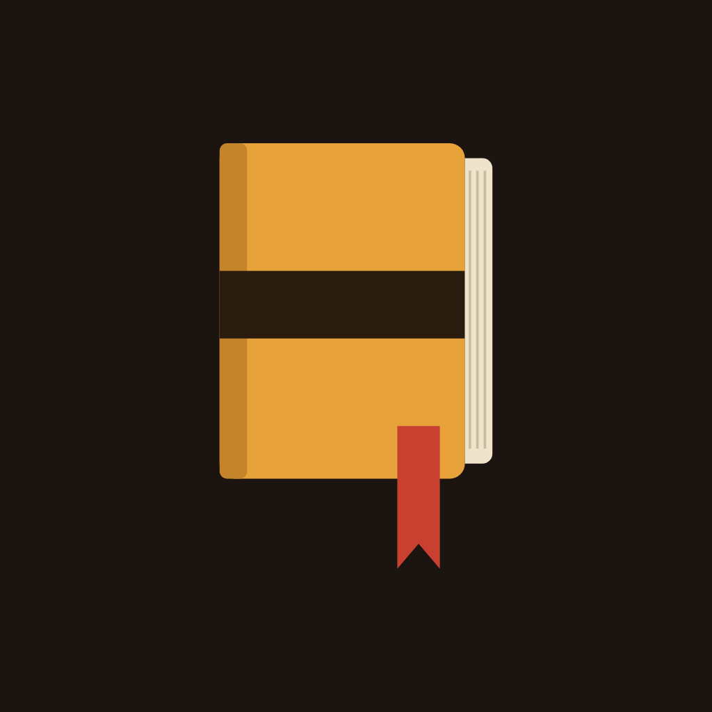

  

<h1 align="center">Due Back</h1>

  <strong>An audiobook player for a collection that lives on a USB drive.</strong>

---

A serious audiobook collection doesn't fit on a phone. One unabridged novel is
a gigabyte and a half, and the usual answer is to stream it from someone else's
server — which fails on a plane, in a basement, and on the day the service
drops the book you were halfway through.

Due Back keeps the collection on a USB drive. Plug the drive in when you want
to swap books, carry three or four at a time, and put them back when you want
the space. The library stays browsable with the drive in a drawer, and your
place, your notes and your listening history never leave your own hardware.

It's for people who already have audiobook files. It doesn't sell, lend or
include any.

## What it does

Point it at a folder and it reads the titles, authors, narrators, chapters and
cover art out of the files — no audio is copied, and a folder of a hundred
loose MP3s plays as one book with one timeline.

Press and hold a cover to check a book out, which copies it to the phone. A tap
never starts a copy, so a stray thumb can't pull 1.5 GB onto your phone. Return
it and the space comes back; your place, notes and history stay. Check one out
with the drive unplugged and it waits on hold until you next connect.

There's a storage budget you set, shelves that sort seven ways, notes you can
take without leaving the player, a character index for books with casts you
can't keep straight, and listening stats. Everything gets written back to the
drive, so a second phone pointed at the same library picks up where the first
left off.

It also connects to an [Audiobookshelf](https://www.audiobookshelf.org/) server
if you run one.

## A few things that were harder than they look

**Scanning never copies audio.** Book details come out of byte-range reads
against the container — the atoms at the head of an `.m4b`, the ID3 frames of
an `.mp3`. A one-gigabyte audiobook is read in 164 KB across three reads. File
size barely matters, only the number of seeks, which is what makes a library on
a slow USB drive feel local.

**A book's identity is a content sample, not its path.** Rename or move a
folder and you keep your place, because the next scan recognises the book
rather than minting a new one.

**Copies are atomic and resumable.** Parts stream into a staging folder and get
size-checked before anything moves into place, so a half-copied book is never
visible as a book. Pull the drive out mid-copy and the next attempt carries on
from the last verified part.

**Syncing has no server.** The drive holds a `.dueback` folder of generations.
Two phones merge it field by field; a note edited on both sides is kept as a
conflicted copy rather than quietly overwritten. There's no account and nothing
to sign into.

**792 tests, no device needed.** Node's own test runner over synthetic audio
fixtures, including a fake SAF drive that reproduces Android's real copy and
move semantics — so the scanner, the copy path and the sync merge are all
testable on a laptop. Everything that can't be is tested by hand on a Pixel
with a real drive, and [docs/STATE.md](docs/STATE.md) says which is which.

More, including the parts that went wrong:
[docs/DEVELOPMENT.md](docs/DEVELOPMENT.md) ·
[docs/KNOWLEDGE.md](docs/KNOWLEDGE.md).

## Status

In development, used daily by its author. No store release yet.

Expo SDK 57, React Native 0.86, TypeScript — about 37,000 lines. Android is the
tested platform.

## Privacy

No account, no server, no analytics, no advertising. Your library and reading
data stay on your device, plus whatever drive you back them up to and whatever
Audiobookshelf server you connect yourself.
[Full policy](docs/PRIVACY.md).

## Contact

[duebackapp@gmail.com](mailto:duebackapp@gmail.com)

## License

[MIT](LICENSE)
